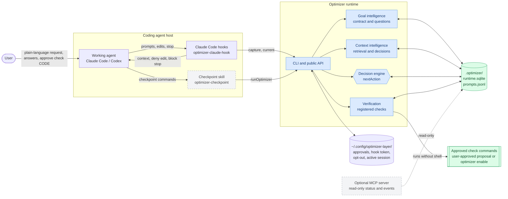
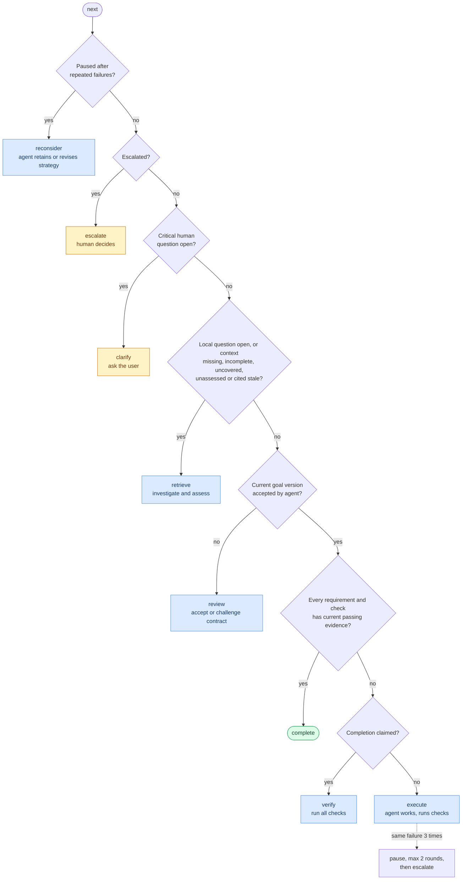

# Optimizer Layer

A local optimization and coordination layer for existing coding agents. Its goal is to reduce the total work needed to reach a verified user outcome: execution, context retrieval, retries, verification, human coordination, and the optimizer's own overhead.

The working agent implements the task. Optimizer Layer maintains the goal contract, retrieves evidence, coordinates decisions, observes registered checks, and verifies completion. The user retains authority over requirements and consequential choices.

The current prototype delivers a bounded goal-to-verification cycle. Improved efficiency remains a research hypothesis; the recorded demonstration does not establish a speed, token, or quality advantage.

## Quick start with Claude Code

Requires Node.js 24.18.x.

**1. Install (once per machine).**

From npm:

```sh
npm install -g @optimizer-layer/runtime @optimizer-layer/agent-adapter @optimizer-layer/mcp
```

The hooks in `agent-adapter` call the `optimizer` command from `runtime`, so install both; the hook installer refuses to run without it. `mcp` is an optional read-only MCP server with a larger dependency tree; leave it out if you don't use MCP.

Or from a [GitHub release](https://github.com/Ak1Ena/optimizer-layer/releases), which contains the same three package tarballs and `SHA256SUMS`:

```sh
mkdir optimizer-release && cd optimizer-release
gh release download --repo Ak1Ena/optimizer-layer --pattern '*.tgz' --pattern SHA256SUMS
shasum -a 256 -c SHA256SUMS
npm install -g ./optimizer-layer-*.tgz
```

To build from source instead: `npm ci && npm run build`, then `npm pack ./dist/npm/runtime ./dist/npm/adapter ./dist/npm/mcp` and install those tarballs.

Maintainers publish a release by bumping the version in `packages/*/package.json` and pushing a matching tag (`git tag v0.3.0 && git push origin v0.3.0`). The [release workflow](.github/workflows/release.yml) runs tests, typecheck, lint and build, then creates a draft GitHub release with the tarballs. Publishing that draft on GitHub triggers the [npm-publish workflow](.github/workflows/npm-publish.yml), which verifies the checksums and publishes the same tarballs to npm with provenance when the repository has an `NPM_TOKEN` secret (skipped otherwise; versions already on npm are skipped). To publish an existing release, run the npm-publish workflow manually with its tag.

The binaries use `#!/usr/bin/env node`. If your default `node` is older than 24.18, run them through a wrapper that calls Node.js 24 explicitly, because older versions lack `node:sqlite`.

**2. Install the Claude Code hooks (once per machine).** Pick one mode:

```sh
optimizer-claude-hook install               # opt-in (default): only folders you enable in step 3
optimizer-claude-hook install --always-on   # global: every folder, no enable step
```

Run either command again to switch modes. This merges hook entries into `~/.claude/settings.json`, writing `settings.json.optimizer-backup` first and keeping your other settings and hooks. A `SessionStart` entry runs `optimizer-claude-hook ensure`, which silently repairs the other entries if something removed them, keeping the mode you installed. Remove everything with `optimizer-claude-hook uninstall`. Start a new Claude Code session afterwards.

**3. Turn it on per project (opt-in only; skip with `--always-on`).** The hooks do nothing in a folder until you enable it.

```sh
cd /path/to/project
optimizer enable --project .
```

Run it in your own terminal: `enable` and `disable` apply directly only when stdin and stdout are a terminal. From anywhere else (Claude's Bash tool, or Claude Code's `!` prefix) they change nothing and print an approval phrase such as `approve enable 7c1e`; type that phrase as your next Claude Code message to apply it. Only your own typed prompt can approve, so the agent cannot switch the optimizer off or replace your checks. `OPTIMIZER_DISABLED=1` in the environment you start Claude Code from stays your own kill switch.

This creates `.optimizer/` there and, inside a git repository, adds `.optimizer/` to `.git/info/exclude` so it never shows up in `git status`. Sessions in subfolders use the nearest parent with `.optimizer/`. In every other folder the hooks stay silent and create nothing.

With `--always-on`, the first prompt in any folder creates `.optimizer/` there instead.

**4. Chat normally.**

```text
claude
> parseCount should reject garbage input instead of returning 0
```

Claude drafts a goal contract from your words, asks any open questions, and waits for your approval before starting the task. Your plain-language answers are recorded as your decisions. Until a task starts, nothing is blocked. Once it starts, edits follow the contract and Claude cannot finish until your check passes, but it may stop to wait for you. Questions that change no files need no contract.

**First task in a project: approve the check.** A task needs a check command that proves it is done, for example `npm test`, `pytest` or `go test ./...`. Claude proposes one with `optimizer propose-check`, and the hook shows you the exact argv with a short code. Reply `approve check 3f9a` (your code) to approve it; only your own typed prompt can approve. The check is reused by later tasks in that project. Checks run without a shell, so `|`, `&&`, `;` and `>` are rejected; point it at a script if you need more. You can also set it yourself with `optimizer enable --project . --check 'npm test'`.

Useful commands:

```sh
optimizer current --project .   # active task and next step
optimizer disable --project .   # turn this project off; history is kept
optimizer dashboard             # local read-only web page of all projects
OPTIMIZER_DISABLED=1 claude     # one session with every optimizer hook off
```

See [Claude Code hooks](#claude-code-hooks) for details and limits.

## How it works

1. **Define the goal.** Extract requirements, acceptance criteria, and unresolved questions from an explicitly selected request.
2. **Retrieve evidence.** Find relevant project files and explicitly imported prior user decisions, retaining source references and freshness checks.
3. **Review the contract.** Resolve consequential uncertainty, assess context sufficiency, and let the working agent accept or challenge the goal contract.
4. **Execute and observe.** The agent performs the authorized task. The runtime executes registered checks and records their actual outcomes.
5. **Reconsider when justified.** Repeated check failures request a cooperative pause. The agent explains whether to retain or revise its strategy.
6. **Verify the outcome.** Completion requires current passing evidence for every requirement and registered check. An agent's completion claim is recorded separately.

## Architecture

The project is a TypeScript ESM workspace on Node.js 24.18.x. SQLite stores project-bound events and reconstructable session state; Zod validates external inputs. Core behavior runs locally without a model API key.

| Package | Responsibility |
| --- | --- |
| [Runtime](packages/runtime/README.md) | Goal/context intelligence, contract review, decision policies, persistence, subprocess checks, verification, public API, and `optimizer` CLI. |
| [Agent adapter](packages/adapter/README.md) | Thin CLI transport and an installable checkpoint skill for a working coding agent. |
| [MCP](packages/mcp/README.md) | Optional read-only session status and event views through the official MCP SDK. |

The runtime owns state and policy. Adapters and MCP use its public interfaces. Each project stores its private runtime database at `.optimizer/runtime.sqlite`.

### High-level system architecture



### Inside the decision engine

Every hook and checkpoint asks the runtime for the next action. `nextAction` re-derives it from the replayed session state, after dropping stale context, answers and evidence, and takes the first rule that applies:



**Tiers** (see [the adaptive execution design](docs/superpowers/specs/2026-10-27-adaptive-execution-design.md)). The controller picks a tier when a session starts and records it as a `tier.decided` event with its trigger. A session is *light* when no human or local question is open, every requirement's acceptance is the user-approved project checks (controller-started tasks: R1 is your prompt), and every check is inexpensive: its last recorded run took under 60 s, or, before any run, its timeout is at most 60 s. On the light tier the runtime retrieves context itself and records context sufficiency and contract review as `policy` (with the rule that justified them) instead of asking the agent, so the first edit is allowed at once and the agent's only optimizer step is `verify` (or `check`). Stale context alone does not block light verification, because the runtime refreshes context before running checks; a changed pinned verifier artifact still does. Everything else is *standard*, today's flow above. A light session escalates to standard, never back, when a human question opens (clarify), a local question opens, an agent assessment or review replaces the policy records, a check runs 60 s or longer, or a check fails twice in a row or after a completion claim (the session then pauses for reconsideration).

The Claude Code hooks ask the runtime controller before every file edit and Bash command. Once a task has started, protected actions (file edits and any Bash command off the read-only allowlist) are denied unless the controller's decision is `PROCEED`, `RUN_VERIFICATION` or `COMPLETE`, and the end of a turn is blocked until the task is verified, except while waiting for the user. In a project with an approved check, the first protected action starts a task from your latest prompt even if the agent never called the optimizer. Reads are never blocked.

## Current capabilities

Implemented: structured goal extraction, versioned contract review and challenge, bounded lexical context retrieval, provenance-aware decision import, context sufficiency assessment, durable event replay, cooperative reconsideration, and independent registered-command verification.

The shipped integrations are explicit skill/CLI checkpoints, opt-in (or always-on) Claude Code hooks, and a local read-only dashboard (below). The runtime can gate its own checks. The hooks deny file edits and non-read-only Bash commands and block ending a turn according to the runtime controller's decision; they are tested with real hook JSON on stdin. The advisory hooks that preceded the controller were exercised once in a live Claude Code 2.1 session on the parseCount fixture (plain-language request, drafted contract, approval, a denied early edit, verified completion); the controller-driven hooks have not yet been run in a live session. Codex hooks are not implemented.

Broader natural-language interpretation through a replaceable model provider, richer code relationships, native conversation import, and repeated comparative evaluation remain future work. The current goal syntax and limits are documented below.

## Repository layout

```text
CONTEXT.md                    Project vision and confirmed architecture decisions
packages/runtime/             Runtime API, CLI, policy, storage, and tests
packages/adapter/             Checkpoint transport, installable skill, and tests
packages/mcp/                 Optional read-only MCP server and tests
examples/vertical-slice/      Coding fixture, goal, and independent acceptance runner
scripts/                     Packaging and demonstration tools
docs/superpowers/             Designs and implementation plans
docs/runs/                    Implementation ledger and recorded evidence
```

## Setup and checks

Use Node.js 24.18.0 (`nvm use` reads `.nvmrc`). Then:

```sh
npm ci
npm test
npm run typecheck
npm run lint
npm run build
node packages/runtime/src/cli.ts --help
```

Tests use real files, SQLite, subprocesses, and the official MCP client/server. `lint` uses TypeScript's unused-code, fallthrough, return-path, unreachable-code, and unused-label checks. Build emits compiled modules and installable package directories under `dist/npm/{runtime,adapter,mcp}`.

A clean registry-backed `npm ci` followed by tests and build passed on 2026-10-26. `npm run build` removes previous generated output first, so deleted or renamed modules leave no stale files.

To create local installable tarballs after building:

```sh
npm pack ./dist/npm/runtime
npm pack ./dist/npm/adapter
npm pack ./dist/npm/mcp
```

The runtime package exposes `optimizer`; the optional MCP package exposes `optimizer-mcp`. Pack the staged `dist/npm` directories so installed packages use compiled JavaScript. See the package READMEs for embedding the runtime, configuring the adapter, and running MCP.

## Goal contract

Write a goal file using this deliberately small dialect:

```text
- R1: parseCount accepts nonnegative integer counts.
Acceptance R1: Valid decimal digit strings preserve their numeric value.
- R2: parseCount handles invalid input according to the confirmed policy.
Acceptance R2: Invalid values match the prior user decision.
Question human Q1: What is the invalid-input policy?
Question local Q2: Which module implements parseCount?
```

Plain prose is retained as a requirement and triggers a critical missing-acceptance question. Unsupported semantics are not guessed. Critical human questions need actual user decisions; local questions need current source evidence. Context scores alone do not grant permission to proceed. The working agent must cite sources and explain sufficiency.

Register independent checks in a separate operator-selected JSON file:

```json
[
  {
    "id": "acceptance",
    "requirementIds": ["R1", "R2"],
    "argv": ["node", "/trusted/acceptance.mjs", "/absolute/project"],
    "timeoutMs": 5000
  }
]
```

These trusted commands run without a shell but with the caller's privileges. Retrieved code, goal text, and transcripts cannot register commands. Every requirement needs checks; every registered check must have current passing evidence before completion.

## Coding-agent workflow

During development replace `optimizer` below with `node packages/runtime/src/cli.ts`. After building, use `node packages/runtime/dist/cli.js` or an installed package's `optimizer` binary. All paths are explicit.

```sh
optimizer start --project /absolute/project --request /trusted/goal.md --checks /trusted/checks.json
optimizer history --project /absolute/project --session SESSION --file /trusted/conversation.jsonl
optimizer retrieve --project /absolute/project --session SESSION
optimizer resolve --project /absolute/project --session SESSION --question Q1 --source prior-user:decision:1
optimizer resolve --project /absolute/project --session SESSION --question Q2 --source CONTEXT_ITEM_ID --answer 'parseCount.mjs exports the parser'
optimizer assess --project /absolute/project --session SESSION --kind sufficient --items ITEM_ID,ITEM_ID --rationale 'Explain how the cited sources resolve the next decision.'
optimizer next --project /absolute/project --session SESSION
optimizer status --project /absolute/project --session SESSION
optimizer review --project /absolute/project --session SESSION --kind accept --version VERSION --items ITEM_ID,ITEM_ID --rationale 'Explain why the contract preserves the requested requirements and acceptance.'
optimizer check --project /absolute/project --session SESSION --check acceptance
```

Use the returned state to select actual current item IDs and the latest `state.goal.version` for VERSION. `next` routes to local retrieval, human clarification/escalation, agent contract review/work/reconsideration, local verification, or completion. When a source edit invalidates context, retrieve and assess again. Unresolved questions, pending review, and pauses prevent registered checks from executing.

Contract acceptance is explicit and cites context covering every requirement. Challenge a technical contradiction or consequential missing decision with:

```sh
optimizer review --project /absolute/project --session SESSION --kind challenge --version VERSION --items ITEM_ID --requirement R1 --owner local --rationale 'Describe the requirement concern supported by this evidence.'
```

Use `--owner human` for user-owned decisions. Each challenge creates a critical `review:N` question; resolve it through the same cited local-answer or imported user-decision flow. The runtime preserves requirement statements and registered checks. A response for a stale version, missing citation, or unresolved challenge is rejected. Imported authority, resolved answers, and new challenges advance the contract version and require fresh acceptance. Source edits alone require fresh context; if they reopen a cited local answer, resolve it and review the updated contract. Two challenges are allowed before another challenge escalates to the human. This bound is a prototype policy, not an evaluated optimum.

Existing event logs without review data reopen with pending review. Earlier completion evidence and completion claims cannot bypass this checkpoint.

Three matching failed check outcomes request Pause. The working agent reviews evidence and may retain its strategy with justification:

```sh
optimizer reconsider --project /absolute/project --session SESSION --strategy retain --rationale 'Explain why the plan still holds and what the evidence changes.'
optimizer claim --project /absolute/project --session SESSION
optimizer verify --project /absolute/project --session SESSION
optimizer metrics --project /absolute/project --session SESSION
```

Two reconsideration rounds are allowed; persistent failure then escalates to the human. `claim` never proves success. Verification detects stale source/check evidence and source mutations during a check. Independent verifier file hashes are pinned at registration. Helpers outside argv should be explicitly registered as artifacts. This does not defend against a malicious process with the same OS account modifying the optimizer itself.

Install the adapter's [checkpoint skill](packages/adapter/skill/optimizer-checkpoint/SKILL.md) in the coding agent's skill directory using its normal local installation mechanism. Installation is explicit; the runtime does not rewrite host configuration. See [adapter documentation](packages/adapter/README.md). For Claude Code, the hooks below replace typing these checkpoints by hand.

## Claude Code hooks

The adapter's `optimizer-claude-hook` lets you chat in plain language while the runtime keeps the agent on a goal contract. One-time machine setup (writes `settings.json.optimizer-backup` first, idempotent, preserves other settings and hooks):

```sh
optimizer-claude-hook install                        # opt-in; merges into ~/.claude/settings.json
optimizer-claude-hook install --always-on            # every folder, no enable step
optimizer-claude-hook install --settings /path/settings.json
optimizer-claude-hook uninstall                      # removes only its own entries
```

The installer pins the install mode (`OPTIMIZER_MODE='opt-in'` or `'always-on'`), the current Node.js executable and the runtime executable (`OPTIMIZER_BIN`, else `optimizer` on `PATH`) into the hook command. Re-running `install` replaces the entries, so the last install's mode wins. It adds `UserPromptSubmit`, `PreToolUse`, `Stop`, `SubagentStart`, and a `SessionStart` (`startup|resume`) entry running `optimizer-claude-hook ensure`. Each entry sets Claude Code's hook `timeout` to 60 seconds; every runtime call inside it has a 15-second deadline. Subagents follow the same gate as the main agent. While a session is active, `SubagentStart` gives each subagent the contract summary, phase and decision. A subagent's instructions come from the main agent, so they never count as user decisions, and subagents are not blocked from stopping; the main agent owns review, resolution and completion. `ensure` prints nothing and changes nothing while every entry is in place; otherwise it reinstalls them in the mode the existing entries record, replacing entries that point to a moved path. Entries from an install that predates modes carry no marker and behaved always-on, so `ensure` keeps them always-on; with no entries at all it installs opt-in. It never fails the session.

**Opt-in (default).** A folder is handled only when its per-user record says you enabled it with `optimizer enable --project P` (with or without `--check`). Elsewhere every hook event is silent: no `.optimizer/`, no prompt capture, no per-user record, no registry entry, no git exclude, and the runtime is not started. The only exception is the spawn-free `PreToolUse` guard described below, so the agent cannot enable a folder or write approvals itself. A per-user record created by always-on hooks does not count as enabling. `enable` without `--check` keeps the project's current checks (none at first) and creates `.optimizer/`; the agent then proposes a check and you approve it by code. With a `package.json` test script, `enable --yes` approves `npm test` directly.

**Always on (`--always-on`).** Every folder is a project. The project root is the nearest ancestor of the session's working directory that already has `.optimizer/`, else the working directory itself; never the filesystem root or a path inside `.optimizer/`. Your home directory can be a project, but only when Claude runs in it, so a `~/.optimizer/` never absorbs the projects below it. On the first captured prompt the runtime creates `.optimizer/` (mode 0700, files 0600) for runtime data (`runtime.sqlite`, `prompts.jsonl`, drafts, loop-guard state), creates the project's per-user record `$XDG_CONFIG_HOME/optimizer-layer/projects/<sha256 of the root>.json` (default under `~/.config`, mode 0600) holding the hook token, approved checks, pending proposal, opt-out flag and active session, lists the project in `optimizer-layer/projects.json` for the dashboard, and, inside a git work tree, adds `.optimizer/` once to `.git/info/exclude`. Tracked `.gitignore` files are never edited. Turn a project off with `optimizer disable --project .` in either mode (history is kept; `enable` turns it back on), or every project for a whole session with `OPTIMIZER_DISABLED=1`.

**Check approval.** A project needs approved check commands before a task can start; `start` without them fails and names `propose-check`. The agent runs `optimizer propose-check --project P --check CMD [--check CMD ...] [--timeout-ms N]`, which stores a pending proposal with a random four-hex-digit code and replaces any earlier one. While a proposal is pending, every prompt shows the agent the exact argv and the phrase `approve check CODE`. When your own prompt contains that phrase with the matching code (case-insensitive, whole words), the runtime makes those checks the project checks (replacing old ones, verifier artifacts pinned) and clears the proposal. Nothing else activates a proposal. `optimizer enable --project . --check 'npm test' [--check ...] [--timeout-ms 30000]` sets checks directly if you prefer the CLI; without `--check` it keeps the current checks, and `--yes` accepts a `package.json` test script as `npm test`. Check commands are split into argv without a shell; the shell metacharacters ``| ; & $ > < ` `` are rejected, and the executable is resolved to an absolute path. Each project check covers every requirement of every task.

**On each prompt** the hook captures your message into `.optimizer/prompts.jsonl`. It injects nothing unless the agent has something to do: an approval outcome, a pending check proposal (its argv and `approve check CODE` phrase), or an open session. A light session gets one line (edit, then `optimizer verify`); a standard session gets its phase, structured decision and checkpoint. A project without an approved check is *unmanaged*: nothing there can be verified and nothing is gated. The hook no longer injects propose-check onboarding there; ask the agent to propose a check (it runs `optimizer propose-check` and shows you the approval phrase) or run `optimizer enable --check CMD` yourself. `optimizer start` there fails and names `propose-check`. Standard sessions keep the `--source prompt:ID` hint for answering a human question; light sessions omit it, since an open human question escalates them to standard. The goal dialect is shown only when a protected action is denied because no captured prompt can start a contract. The agent may also draft a contract under `.optimizer/drafts/`, show it to you, and run `optimizer start --project P --request DRAFT` after you approve (`--replace` supersedes an unfinished session).

**Enforcement** (see [the design](docs/superpowers/specs/2026-10-26-enforced-lifecycle-design.md)). An agent's `optimizer start --replace` cannot drop the R1 of a contract the controller started from your prompt: the replacement must keep it verbatim. A verified session is closed: later edits never reopen it or change its result, and new work starts a new session (a new `optimizer run` needs no `--replace`). So a protected edit after verification starts a new contract from your latest prompt: on the light tier it is allowed at once, on the standard tier it is denied until that contract is reviewed, and Stop blocks until it verifies. `PreToolUse` covers Edit, Write, MultiEdit, NotebookEdit and Bash and calls the runtime's `gate`. Read, Grep, Glob and read-only Bash commands (`ls`, `cat`, `rg`, `git status`, the approved check command, ...) always pass and start nothing. In a managed project (one with an approved check) the first protected action with no open task makes the runtime start a contract from your latest captured prompt (R1 is your prompt verbatim, accepted when every approved check passes); on the light tier that action is allowed, on the standard tier it is denied with the next checkpoint; later protected actions pass only while the decision is `PROCEED`, `RUN_VERIFICATION` or `COMPLETE`. Stop is blocked while the task is unverified, at most three consecutive times and never twice for unchanged state; then the hook records the task as `blocked` and says it is blocked and unverified, never complete. If the runtime cannot answer during an active task, file edits and all Bash commands are denied as "optimizer unavailable" while read tools keep working. Without an active task an unmanaged project never starts the runtime from `PreToolUse` or `Stop`, and runtime failures fail open. A session that reaches verified `complete` releases the active-session pointer. The hooks never write runtime state through a symlink planted in `.optimizer/`.

**Limits of plugin mode.** Only Edit, Write, MultiEdit, NotebookEdit and Bash are gated; MCP tools, web tools and edits outside the project root are not. Nothing is enforced when Claude Code runs without these hooks (uninstalled, another settings file, `OPTIMIZER_DISABLED=1`). Writes made inside an allowlisted program, such as the approved check command or a script it runs, are not seen. Checkpoints happen at tool boundaries, so the agent is denied actions but never truly paused, and it can end its turn once the Stop budget is spent (the task is then recorded as blocked). A same-user process can still read the per-user record, call the runtime directly or change state outside the hooks.

## Managed execution

```sh
optimizer run --project /abs/project --prompt-file task.txt [--max-turns 30] [--timeout-ms 1800000] [--claude PATH] [--hook PATH] \
  [--claude-args="--permission-mode acceptEdits --allowedTools Bash"]
```

Managed Execution Mode closes the "hooks not installed" and "agent never called the optimizer" paths for the runs it launches. It needs a managed project: enabled, with at least one approved check. `run` then does five things.

1. It records the prompt file in the authenticated capture log as a controller row (`run:ID`). That row identifies the request but carries no human authority: it cannot answer human questions or approve checks, and the hook gate never starts a contract from it. `run` refuses to start from inside a managed agent or a hook (`OPTIMIZER_MANAGED_RUN` or `OPTIMIZER_HOOK_TOKEN` set).
2. Before the agent starts, it starts the contract through the controller (R1 = the file verbatim, accepted when every approved check passes) and retrieves context. An unfinished active task makes `run` fail instead of replacing it.
3. It writes a private settings file (0600, in a fresh temporary directory, deleted afterwards). Its hooks carry `OPTIMIZER_MODE='managed'`, which the hook treats as tracked and enforced whatever your global install mode is.
4. It launches `claude -p --settings FILE --append-system-prompt PROTOCOL --max-turns N --output-format json` without a shell, with the project as working directory, the prompt on stdin and a hard timeout (the agent is killed when it expires). `--claude` and `--hook` default to `claude` and `optimizer-claude-hook` on `PATH`. `--claude-args="..."` (the `=` form, because the value starts with a dash) appends extra arguments, split on whitespace without a shell. Quotes, shell metacharacters, and the flags `run` owns (`-p`, `--settings`, `--append-system-prompt`, `--max-turns`, `--output-format`, `--dangerously-skip-permissions`) are refused. Headless `claude -p` needs a permission mode such as `acceptEdits` to edit at all; the optimizer hooks still deny what the contract does not allow. The hooks call `OPTIMIZER_BIN`, else the running `optimizer` executable.
5. After the agent exits, the controller runs `verify` itself and prints `{sessionId, promptId, outcome, phase, verifiedRequirementIds, evidence, agentExitCode, agentSignal, timedOut, turns, usage, agentReportedError, finalMessage, timings, cost}`. `turns`, `usage` and `finalMessage` come from Claude Code's JSON output and are `null` when it reports none; nothing is estimated. The exit status is 0 only for outcome `VERIFIED`.

`cost` says where the run's cost went, and `optimizer metrics --project P --session ID` prints the same breakdown later (for hook-mode sessions too): the agent's tokens, turns and cost as Claude Code reported them (`null` in hook mode), the exact bytes of optimizer-authored text put in the model's context (the appended system prompt, hook context, deny and Stop reasons, with subagent context apart; not the total model input), wall clock per optimizer component (model tokens `0`: none calls a model), hook and runtime-call overhead, and rework (failed checks, re-retrievals, re-reviews, reconsiderations, Stop blocks, tier escalations with their trigger). Details in the [runtime README](packages/runtime/README.md).

On the light tier the agent's protocol is only: edit, then `optimizer verify` (or `check`). On the standard tier, after the contract is accepted, edits continue under the reviewed context even though each edit makes it stale; fresh `retrieve`/`assess` is required only before verification (`verify` reports `INCONCLUSIVE` on stale context).

Limits: only runs that `run` launches are covered. A same-user agent can still read files such as the per-user record (including the hook token) by means the classifier cannot see, but the token does not grant `enable`, `disable` or check changes: those need your terminal or your typed approval. With `CLAUDE_PROJECT_DIR` set (Claude Code sets it for hooks), gated tools are denied while the shell's working directory is outside a managed project. Unquoted globs and brace expansions make a Bash command protected, and a glob in command position is denied outright. Git commands count as reads only at the project root, with no `-C`/`--git-dir`/`--work-tree` and no earlier `cd`, so a committed directory shaped like a repository cannot supply git config. The project's own `.git/config` (never committed) is trusted. Your global hooks still run beside the managed ones. The agent can still write through allowlisted programs (for example the approved check command or a script it runs). Checkpoints happen at tool boundaries. A same-user process outside the run is not controlled.

A captured prompt can answer a human question with `optimizer resolve --question Q1 --source prompt:ID`; only rows written by the hook's `prompt` capture carry that authority. Each row carries an HMAC made with the per-user hook token, and capture needs that token once the project has a per-user record (the first capture creates it). Nothing inside the project is trusted for approvals: a committed `.optimizer/project.json` is ignored, and committed `prompts.jsonl` rows fail the HMAC check. `start` re-checks stored check argv with the `enable` rules, and a check runs only if its argv matches a currently approved project check. When the project is opted out, `check` refuses to run. A folder with no per-user record (plain CLI use without hooks, sessions started with explicit `--checks`) runs the session's own registered checks, and those can come from a runtime database committed to the project, so use explicit `--checks` sessions only in project directories you trust. A same-user agent could still read the per-user record and call the runtime directly; Edit and Write into the per-user store or any `.optimizer/` path outside the root's `drafts/` are denied, and the Bash guard parses the command into shell words and denies an `optimizer` (or `cli.ts`/`cli.js`) invocation with a hook-only subcommand (`enable`, `disable`, `prompt`, `start-from-prompt`, `blocked`, `run`) or with an argument built at runtime, under any wrapper (`env`, `npx`, `sh -c`, `eval`, `xargs`, pipes, subshells) or spelling (quotes, backslashes, `$'..'`, literal variables); shell code read from a pipe (`base64 -d | sh`); running the hook script directly; and commands that mention `optimizer-claude-hook`, `optimizer-layer/projects` or `.optimizer` outside `.optimizer/drafts/`. A command whose program cannot be read (`$X ...`, `$(...) ...`, `eval "$X"`) is denied when it also mentions the optimizer or a hook-only word. `propose-check`, repository paths like `optimizer-layer/`, `prompt.txt`, `$PATH` and `$?` pass. This guard runs without starting the runtime, in every folder, and is best-effort only: an agent can still get around it, for example with an alias, an environment variable set outside the command, or a script file, and the Read tool is not intercepted. Projects with a per-user record reject `start --checks`. Outside an active task, hook infrastructure failures fail open with a one-line stderr diagnostic.

## Dashboard

```sh
optimizer dashboard              # http://127.0.0.1:8790/?token=...
optimizer dashboard --port 0     # any free port
```

Prints `{"url": ...}` and serves a read-only page until you stop it (Ctrl-C). It binds `127.0.0.1` only. Every request needs the random per-start token from the URL and a `Host` of `127.0.0.1:PORT` or `localhost:PORT`. The home page has one row per project, newest activity first: name, a status (Waiting for you, Working, Paused, Verified, Idle), the current or last task, last activity, and approved check count. Projects with no tasks and no pending proposal are hidden behind a "Show N idle projects" button. Click a row (URL hash `#p=<path>` keeps the selection on refresh) for a plain-language next step, requirements marked verified or not yet, open questions, check runs, approved and pending check argv (never code), and older tasks (newest 20 per project). Projects are opened read-only and the page refreshes every 5 s. It never shows captured prompts, resolved answers, check output, approval codes, or the hook token.

## Previous conversation decisions

Explicitly import normalized JSONL from the selected harness conversation:

```json
{"id":"prior-user","projectRoot":"/absolute/project","role":"user","content":"Decision: Invalid counts must throw RangeError.","timestamp":"2026-10-25T12:00:00Z"}
```

Only user-authored `Decision:` lines gain user-decision provenance. Assistant suggestions remain untrusted and are ignored as decisions. Extracted IDs are `ROW_ID:decision:1`, with incrementing suffixes for multiple decisions. Optional `supersedes` lists replace earlier row or decision IDs. Transcript path, line, timestamp, role, and digest are retained and rechecked. Changed/superseded sources reopen affected questions. Import is an explicit operator action, not an identity-authentication mechanism. Automatic native transcript conversion is outside this slice.

## Optional MCP

`optimizer-mcp --project /absolute/project` opens an initialized runtime read-only. The official SDK serves only `optimizer_session_status` and `optimizer_session_events`. Tool arguments cannot select another filesystem root or submit SQL. Responses contain status counts and event metadata; private code/output/rationale is omitted. See [MCP documentation](packages/mcp/README.md).

## Demonstration and limits

```sh
npm run demo:prepare -- /absolute/new/demo-directory
```

This prepares matched baseline/optimized fixtures and a pinned external acceptance runner. An actual coding agent follows the checkpoint skill on the optimized fixture; an independent agent repairs the baseline without optimizer guidance. The preparation script does not pretend to implement the agent. Both runs receive three controlled pre-repair failures to exercise recovery. `npm run demo:report -- /absolute/demo-directory` independently checks final artifacts and records results.

The goal is a working restricted-domain optimizer, not arbitrary natural-language interpretation. Retrieval uses bounded lexical/source-name matches plus explicit agent assessment; there is no semantic search model. Decisions are imported explicitly. Three failures are a demonstrator threshold, not an evaluated optimum. No quality or efficiency advantage has been established by a single fixture comparison. Saved demonstration reports describe the earlier implementation; new or resumed demonstrations must also pass contract review before reporting completion.

## Design and evidence

- [Project context](CONTEXT.md): vision, authority boundaries, components, milestones, and research hypotheses.
- [Binding vertical-slice design](docs/superpowers/specs/2026-10-26-complete-optimizer-design.md) and [implementation plan](docs/superpowers/plans/2026-10-26-vertical-slice.md).
- [Contract review design](docs/superpowers/specs/2026-10-26-contract-review-design.md) and [implementation plan](docs/superpowers/plans/2026-10-26-contract-review.md).
- [Implementation and verification ledger](docs/runs/2026-10-26-implementation.md).
- Historical [coding-agent demonstration](docs/runs/2026-10-26-vertical-slice-results.json) and [packaging evidence](docs/runs/2026-10-26-packaging-results.json).
- Local paths in recorded reports are redacted (`<repo>`, `<node>`, `<home>`).

## License

[MIT](LICENSE)
