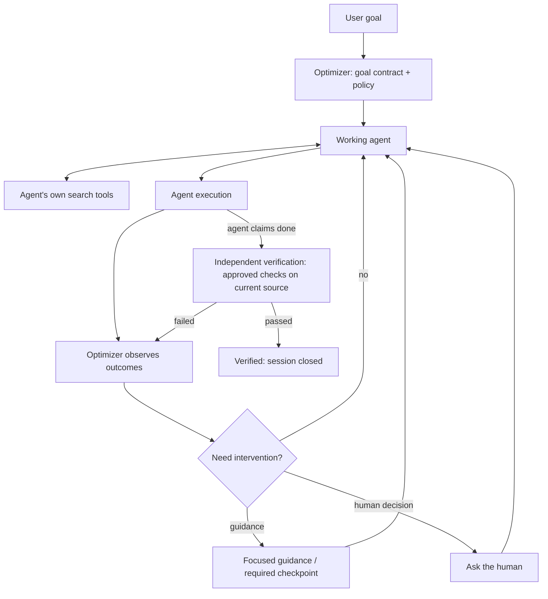

# Adaptive execution: verified goals at the lowest practical cost

Status: implemented (light tier, instrumentation, benchmark harness in `examples/benchmark/`, validated with a fake `claude`). Partial first paid run only (`benchmark-results/run1`, 4 runs); full benchmark pending.

## Objective (amends earlier specs)

Achieve verified user goals with the lowest practical total tokens, wall-clock time, retries and rework, **including the optimizer's own overhead**. Correctness is a hard constraint and the primary quality outcome; it is not the only objective. Earlier specs called efficiency a research hypothesis; this spec makes it an acceptance criterion.

Goal Intelligence, Context Intelligence, the Decision Engine, Adaptive Replanning and Independent Verification all stay. The change is *when* each runs: the Decision Engine invokes a component only when its expected value exceeds its cost, inside fixed policy constraints.

## Evidence: where the cost comes from today

One A/B on the `parseCount` fixture (Sonnet, same prompt, both passed the hidden acceptance check):

| | Plain agent | `optimizer run` |
|---|---|---|
| Wall clock | 28 s | 114 s |
| Turns | 4 | 17 |
| Input tokens read (cache) | ~174k | ~766k |
| Output tokens | 677 | 4,692 |

From the code, every task, however trivial, passes these agent-driven steps (`intelligence.ts` `assessGate`, `nextAction`; `controller.ts` `evaluate`):

1. `retrieve` (required before any protected edit; `assessGate` returns `investigate` with no context).
2. `assess --items ...` (sufficiency with rationale and cited items).
3. `review --version N` (contract accept/challenge).
4. Edit.
5. Edits make the context snapshot stale (`runtime.ts` `#current`, `isContextCurrent`); verification requires current context, so retrieve/assess (and possibly review) repeat.
6. `check`, `claim`, `verify`.

Each step is a turn that re-sends the whole conversation, which is why tokens read scale with turns. A single run is demonstration, not proof; step-level attribution is inferred until instrumentation (below) exists.

## Design

### Tiers chosen by the Decision Engine

The controller picks a tier when a session starts and may escalate (never silently de-escalate) as evidence arrives.

**Light (default when all hold):**
- Goal has no open critical human question and no open local question.
- `acceptanceSource` is `project-checks` (the user-approved checks define done), or every requirement maps to an approved check.
- Approved checks are deterministic and inexpensive (recorded duration under a threshold, default 60 s).
- No failure streak, no prior escalation for this prompt.

Light path:
- The runtime performs retrieval itself at start (it already does in `startFromPrompt`) and records it; no agent turn.
- Sufficiency assessment and contract review are **recorded as policy-satisfied** (`assessment.kind = 'policy'`, `review.kind = 'policy'`) with the rule that justified them, instead of asking the agent. Both remain visible in history.
- Protected edits are allowed immediately.
- Verification uses the approved checks against the current source. Stale *context* alone does not block verification on this tier, because acceptance comes from the checks, not from cited context; stale *check artifacts* (pinned verifier digests) still do.
- Steps: edit, `check`/`verify`. Target: at most one optimizer turn beyond the plain agent.

**Standard / Deep (escalation triggers):**
- Open critical human question → `clarify` (human), as today.
- Requirements not covered by approved checks, or prose acceptance → standard: agent assess + review.
- Check failure streak ≥ 2, or a check that fails after a claim → Adaptive Replanning (reconsider), as today.
- Large or risky change signals (many files touched, reserved paths, check runtime over threshold) → standard.
- Each escalation is recorded as a decision event with its trigger, so the benchmark can attribute cost.

Fixed policy constraints (never skipped on any tier): user-approved checks only; independent verification by the runtime; no agent writes to runtime state; human questions route to the human; verified sessions are terminal.

### Context injection

- UserPromptSubmit injects nothing when the project has no active session, no pending proposal and no checkpoint. Enabled-state signalling becomes one short line only when an action is needed (e.g. a pending check proposal).
- The goal dialect and propose-check instructions are injected only when the agent is about to need them (first protected action in a managed project without a contract), not on every prompt.

### Instrumentation

Recorded per session, from real sources only; missing values stay `null`, never estimated:

- Working-agent input, cache-read, cache-write and output tokens per turn (from Claude Code `usage` in `optimizer run`; from transcript usage when available in hook mode).
- Optimizer-injected context: exact bytes and a token count only if a provider count is available, else bytes.
- Per optimizer component (Goal Intelligence, Context retrieval, Decision, Replanning, Verification): wall-clock and subprocess time (existing `#measure`), plus model usage if a component ever calls a model (none do today: record `0`, not `null`).
- Hook and CLI overhead: wall-clock per hook invocation.
- Retries and rework: failed checks, re-retrievals, re-reviews, reverted edits.
- Tier chosen and every escalation with its trigger.

Implemented as `optimizer metrics --project P --session ID` (cost breakdown beside the raw measurements) and the `cost` block of `optimizer run` output, from `cost.ts`:
- Agent tokens: `optimizer run` appends an `agent.usage` event with `num_turns`, `total_cost_usd`, `duration_ms`, `duration_api_ms`, `usage` (including `iterations` when present) and `modelUsage` copied verbatim from `claude -p --output-format json`. Per-turn values are what Claude Code reports in `usage.iterations`; nothing else is split. Hook mode: `null` (see Q4).
- Injected context: UTF-8 bytes of the `run` system prompt and of each hook output that reaches the model (`additionalContext`, deny reasons, Stop block reasons), per event. No token count: no provider count of these strings is available.
- Components: existing measurements mapped to Goal Intelligence, Context retrieval, Decision, Replanning, Verification (and `other`); `modelTokens: 0` for each.
- Hook overhead: the hook appends one line per invocation to `.optimizer/hook-metrics.jsonl` with its process wall clock and each runtime CLI call it made.
- Rework: from session events (failed checks, re-retrievals, re-assessments, re-reviews, challenges, reconsiderations, `blocked`) and hook lines (Stop blocks). Reverted edits stay `null`: the runtime does not observe them.

### Benchmark (requires explicit user approval before paid runs)

Arms, identical tasks, repository snapshots, model, permissions, turn budget and hidden acceptance tests:
- A. Plain agent.
- B. Controller with all mandatory gates (today's behaviour).
- C. Adaptive optimizer (this spec).

Tasks: straightforward fixes; ambiguous requests where a human decision matters; multi-file changes; tasks with a misleading first approach where replanning should help. Several repetitions per arm.

Metrics: verified goal satisfaction (hidden test), false "done" claims, total tokens, wall-clock, cost per verified success, optimizer overhead share.

Harness: `scripts/benchmark-run.mjs` and `scripts/benchmark-report.mjs` over the tasks in `examples/benchmark/` (see its README). Arm B is today's mandatory gates on every task, forced with `optimizer run --tier standard` (recorded as `tier.decided standard`, trigger `forced by run option`); arm C is plain `optimizer run`.

### Supervision loop (next stage; not implemented)

The optimizer supervises; it does not search for the agent. The agent keeps its own search tools (Read, Grep, LSP, subagents); a retrieval router is not built, because duplicating the agent's search adds cost without new information. Context Intelligence moves from *retrieving* to *observing what the agent has read* and nudging only when something relevant is missing.

"Need intervention?" is decided from cheap, observable signals only. No signal, no intervention, no injected text:

| Signal | Source | Intervention |
|---|---|---|
| Check failed; same failure twice | check evidence | replanning checkpoint (escalate tier) |
| Done claimed before checks pass | Stop hook, claim event | run verification; block Stop until verified or budget spent |
| Edit outside goal scope or into optimizer state | PreToolUse target | deny (state) or one-line scope reminder |
| Open human question, or change to approved checks | goal uncertainties, proposals | ask the human |
| Ambiguous task and a decision/doc file likely answers it, not yet read by the agent | candidate files from the local evidence index (Q7) vs observation states derived from the transcript at Stop | one-line pointer: "`docs/decisions.md` likely decides this; it has not been read" |
| Turn budget for the task nearly spent (managed `optimizer run` only) | `--max-turns` | at the limit, Stop with a report. Token-budget interventions are disabled: hook mode has no trustworthy live usage (Q4) |

Cost rules for the loop:
- Observation is record-only and adds no runtime process when no signal fires. The existing PreToolUse gate already spawns the runtime for every gated tool call in an active or managed project (`packages/adapter/src/claude-hook.ts`); the observer must not add to that count.
- Guidance is at most one short line, counted in injected bytes.
- Observation records tool name, target path and outcome only (never file contents or tool output). Mechanism (measured 2026-10-28, Node 24.18.0, macOS arm64, median/p95): Read, Grep and Glob pass through no hook today. A PostToolUse hook would add one process per tool call, about 280/308 ms (adapter plus runtime import), so it is rejected for the common path. PreToolUse sees only attempts, not success. Chosen: the Stop hook, which already runs and already calls the runtime in an active session, passes `transcript_path` to the runtime, which parses the session's `tool_use`/`tool_result` pairs once and appends the observations in its existing event transaction. That costs 0 per tool call and 0 added spawns; parsing measured 1.7–16 ms for 0.4–2 MB transcripts and about 5.5 ms per MB up to 112 MB; the batch append is not yet measured. The transcript is an undocumented format: a parse failure, an unknown version or a missing `tool_result` makes the affected files `unknown`. Whether an omitted `is_error` means success must be confirmed per Claude Code version against a fixture with known outcomes; until it is, those reads are `unknown`. A PostToolUse hook is reconsidered only if live mid-turn evidence is shown to be worth about 280 ms per call. A file counts as "read" after a successful `Read` of it, or a successful Bash command whose parsed argv is a plain whole-file reader (`cat`, `head`, `tail`, `sed -n`, `less`) naming it; the benchmark arms allow Bash, so `cat docs/decisions.md` must count. Grep/Glob hits, failed reads and other Bash do not prove the agent consumed a file and are recorded as unknown, not as unread. Per-call latency must be measured before the observer is enabled by default.
- The "not yet read" signal cannot find information the agent never discovered by comparing goal terms with read paths: in `invoice-total` and `dedupe-users` the goal text does not name `docs/decisions.md`, which decides the answer. Candidate files must come from a source independent of the agent's reads (Q7).
- Every intervention is recorded with its signal and target, so the benchmark attributes its cost, value and false positives.

Observation semantics. Each (session, file) pair is in exactly one state, and only `confirmed` and `absent` may feed a trigger:
- `confirmed`: a successful `Read` of the file, or a successful Bash command whose parsed argv is a plain whole-file reader naming it (as above).
- `absent`: observation was complete for the whole session (every tool call accounted for, no parse failure, no subagent activity left unobserved) and no confirmed read of the file occurred. Completeness also requires that the transcript is known to be flushed when Stop reads it. That is unverified (Q4), so no `absent` is produced until the flush measurement passes or a hook-visible end marker for the current turn is found in the transcript.
- `unknown`: anything else, including Grep/Glob hits, failed reads, Bash that is not a plain reader (pipes, scripts, `node -e`, `rg`, `find -exec`), subagent tool calls not observed, and any gap or parse failure in the record. An `unknown` never becomes `absent` by default, and no pointer fires on it.

Passive observation versus active intervention:
- Passive (allowed now, once its cost is measured within the AC6d limits): record observations and candidate-evidence scores as events. Nothing is injected, nothing is blocked, and agent behaviour is unchanged. The existing low-cost event collection and today's checkpoints are unchanged. Scope: only sessions where the Stop hook already calls the runtime (an open, not yet verified session); Stop returns early for verified or untracked sessions (`packages/adapter/src/claude-hook.ts`), and those are not observed rather than given an extra spawn.
- Active (disabled until AC6 passes on held-out tasks): pointer injection and any new blocking checkpoint. It ships behind an explicit opt-in, default off. Delivering a pointer at Stop is a blocking checkpoint (`decision: block` forces another agent turn), so it is active by definition: it counts against the existing Stop block budget and shares its loop guard, and it never fires once that budget is spent. No new mandatory supervision checkpoint is added until its signal is shown meaningful (AC6a/AC6b) and its benefit to exceed its overhead (AC6c/AC6d).

Order (revised 2026-10-28): a partial first benchmark (`benchmark-results/run1`, 4 runs) shows B and C failing `parse-count` where A passed. Correctness regressions come before new features: that failure is investigated and corrected first. The observer is built only against the revised AC6 below.

## Acceptance criteria

- AC1: On straightforward tasks, C's median tokens and wall-clock are within 1.25× of A, with equal or better verified satisfaction.
- AC2: On ambiguous/complex tasks, C's verified satisfaction is at least A's, and cost per verified success is no worse than B's.
- AC3: Every run reports the cost categories above, with `null` where no real measurement exists.
- AC4: No policy constraint above is bypassed on any tier (regression tests).
- AC5: No efficiency claim in README or release notes until benchmark results support it.
- AC6 (supervision loop; revised 2026-10-28, replaces the original, which already failed as written because the PreToolUse gate spawns on every gated call). Evaluated against independent ground truth, not against the observer's own signals:
  - Ground truth: each benchmark task declares, in its hidden folder (never visible to the agent or the optimizer), the critical-context files without which the hidden acceptance cannot be met (`invoice-total`, `dedupe-users`: `docs/decisions.md`; straightforward tasks: none). Labels are written with the task, before observer runs.
  - A run has a *context gap* when, without observer guidance, the agent claims done without having read a critical-context file (as defined in the cost rules). Gaps are identified only on observer-off runs or replayed observer-off traces; on observer-on runs a working pointer removes the gap, so those runs cannot define the denominator.
  - AC6a detection: replaying each gap trace through the observer, it emits a pointer to the missing file before the agent's first done claim. Measured as recall over gap traces. On observer-on runs, the share of pointers the agent follows with a read is reported separately.
  - AC6b false interventions: any pointer to a file outside the task's critical-context set, to a file already read, or on a task with an empty set. Measured per run, and counted on every task class.
  - AC6c outcome: C with the observer versus C without it (same build otherwise, paired by task and repetition): verified satisfaction on ambiguous tasks rises by at least the minimum effect fixed in Q6, and AC1 still holds on straightforward tasks.
  - AC6d overhead: the observer adds no hook and no runtime spawn on any tool call (observer-on minus observer-off spawn count on the same trace is zero); added Stop-time latency (transcript parse, index scan and event append) p50/p95, injected bytes and attributable tokens are reported and counted in cost per verified success.
  - Evaluation plan: AC6a/AC6b/AC6d are first measured offline by replaying recorded tool traces (benchmark transcripts) through the observer, which needs no paid run. AC6c needs paid runs and separate approval. It uses held-out tasks and repeated paired runs per task (task count and repetitions in Q6) and reports each difference with a 95% confidence interval; a single successful run is not evidence. A difference whose interval includes zero is reported as inconclusive, not as a pass. Pass thresholds for recall, false-intervention rate and overhead are a human decision (Q6) and are fixed before the runs.

## Decisions (user, 2026-10-27)

- Q1: Target is within 1.25× of the plain agent on straightforward tasks (AC1 as written).
- Q2: Yes. The light tier records assessment and review as policy-satisfied, with the justifying rule, and asks no agent turn when approved checks define acceptance.
- Q3: Benchmark size is decided after the light tier is implemented and local tests pass. No paid run before that decision.
- Supervision loop (user diagram): adopted, with an explicit verification gate, a path to the human, and the intervention signals above. No retrieval router; the agent keeps its own search.

## Open questions

- Question local Q4: Can hook mode read per-turn token usage reliably from the Claude Code transcript, or only `optimizer run`?
  Answer (2026-10-27): readable, but not proven reliable, so hook mode records `null`. A sample of local transcripts from Claude Code 2.1.283 to 2.1.300 shows each API response written as several `assistant` lines (one per content block) sharing `message.id`, all with identical `usage` (final output tokens, cache fields, `iterations`), plus `<synthetic>` messages with zero usage. Summing per unique `message.id` would therefore work on these versions. It is not used because: the transcript is an undocumented internal format with no stability promise (older versions are reported to have written streaming placeholder `output_tokens`); subagent turns are written to separate files; the Stop hook can run before the last line is flushed; and no transcript sum has been checked against the `claude -p` result `usage` of the same session. One managed run comparing the two would settle it; until then only `optimizer run` reports agent tokens.
  Update (2026-10-28): that comparison already exists and is not repeated. In the two managed runs of `benchmark-results/run1`, transcript usage summed per unique `message.id` equals the `claude -p` result `usage` exactly on input, output, cache-read and cache-write tokens. A further sample of 100 transcripts from Claude Code 2.1.310 to 2.1.312 confirmed identical token counters on duplicate `message.id` lines, zero usage on `<synthetic>` lines, and no placeholder `output_tokens`. Hook mode still records `null`: the hook discards `transcript_path`, and two things remain unverified: (1) subagent usage, written to `<session>/subagents/agent-<id>.jsonl`, must be added for a session total (one sampled parent plus child matched the recorded total, but one unrelated session recorded more than its visible responses, cause unknown); (2) whether the Stop hook runs before the final lines are flushed. No token usage is estimated or inferred when these are unverified.
  Decision (user, 2026-10-28): hook-mode usage stays unknown (`null`) while trustworthy live usage is unavailable, and token-budget interventions that depend on it are disabled. Subagent attribution and Stop-hook flush timing are investigated separately, each as its own measurement, and neither blocks other work.
- Question local Q5: Check-duration threshold for "inexpensive" (default 60 s) — measure on real projects.
  Answer (2026-10-28): 60 s stays as a provisional heuristic. It is not an empirically optimized threshold. Measured on Node 24.18.0: each benchmark task check about 0.2 s, a small local project's `npm test` about 1.2 s, this repository's `npm test` 259–270 s. The cutoff separates these, but nothing was measured between about 2 s and 259 s, so any value in that range would classify them the same way. The cutoff applies three ways: the latest passing duration of the same argv across the project's sessions (`packages/runtime/src/store.ts`), any check evidence in the current session (`packages/runtime/src/intelligence.ts`), and, with no passing history, the check's configured timeout (`packages/runtime/src/runtime.ts`; CLI default 30 s). Check latency and verification outcomes are collected per tier before the value is revised.
- Question human Q6: Pass thresholds for AC6a recall, AC6b false-intervention rate, AC6c minimum effect size and AC6d overhead, and the repetition count for AC6c?
  Proposed (2026-10-28, numbers awaiting user approval; nothing is enabled on them):
  - Trigger rule (deterministic, no model inference): a pointer fires only at the agent's first done claim, only for a candidate whose evidence score is at or above the frozen threshold and whose observation state is `absent`, at most once per file and at most 2 per session. No pointer fires on `unknown`, on a task with no candidate above threshold, or after the session is verified.
  - Phase 1, pilot (the 8 existing tasks): calibrate the threshold and rules offline on repository content and recorded traces. Results are reported as calibration only and support no effect claim.
  - Phase 2, freeze: threshold, rules and ground-truth labels are committed before any held-out task is run.
  - Phase 3, held-out: at least 6 new ambiguous tasks and 6 new straightforward tasks, written and labelled after the freeze and not used for tuning, with at least 5 paired repetitions per task per arm (C observer on versus off), about 120 paid runs (separate approval).
  - Pass, all required: AC6a recall at least 0.8 over at least 10 held-out gap traces (fewer gap traces: inconclusive); AC6b false pointers on at most 5% of straightforward runs and at most 20% of all pointers; AC6c ambiguous-task verified satisfaction at least 15 percentage points higher than observer-off, with a 95% confidence interval bootstrapped over tasks (not runs) whose lower bound is above 0, and AC1 holding; AC6d zero added spawns, added Stop-time latency at most 50 ms p95 for transcripts up to 10 MB, and cost per verified success no worse than observer-off by more than 10%.
  - No statistical improvement is claimed from one or two tasks; with fewer than 6 held-out ambiguous tasks the outcome is reported as inconclusive.
- Question human Q7: Candidate critical-context source for the "not yet read" signal: a runtime content/link index, or decision files declared in the goal contract?
  Investigated (2026-10-28): a local, deterministic, incremental evidence index, with no external API, no model inference and no new dependency (`scripts/evidence-index-probe.mjs`, offline calibration only). The existing `retrieveContext` (`packages/runtime/src/context.ts`) finds both decision documents but gives no file ranking or alert threshold, and matches control tasks broadly. The probe scans only the task repository, caches tokens, links, SHA-256 and mtime/size per file, re-tokenizes only changed files, and scores each file by goal-term coverage plus a bonus when another file links to it, a further bonus when the prose around that link uses authority words (decision, policy, rule, contract, requirement, specification), and bounded constraint words. No filename or directory is hardcoded; the stop-word, authority-word and constraint-word lists were hand-tuned on the same 8 pilot tasks and count as calibration.
  Result on the 8 pilot tasks: `docs/decisions.md` ranks first in `invoice-total` (2.135) and `dedupe-users` (2.150). At the pilot-calibrated threshold of 1.911, 0/6 control tasks alert; the nearest control is `user-nickname` `docs/csv.md` at 1.688. Index build 0.2–0.4 ms per repository (overall p50 0.28 ms, 41 files), one-file in-memory update about 0.13 ms (warm cache, memory overlay; disk read and watcher cost not measured). Each hook is a new process and no cache is persisted, so in practice every Stop does a full build plus disk reads; persisting the cache is deferred until a larger repository shows the full build exceeds the AC6d budget.
  Limitation, recorded rather than claimed away: this is pilot calibration, not evidence of reliable detection. Without the authority-word bonus, 0/2 ambiguous tasks alert, so success depends on English wording near a link. Unlinked decisions, decisions in code comments or non-text files, paraphrased or misleading prose and ties can defeat it. The current benchmark transcripts also certify no `absent` state (Bash reads were all `unknown`, and Read success depends on the unconfirmed `is_error` convention), so on that data the trigger would never fire. The observer may therefore claim only "candidate decision document not confirmed read", never "critical context unread", until held-out tasks with paraphrased, unlinked and adversarial documents pass AC6a/AC6b. Decision files declared in the goal contract (human-confirmed, with provenance) remain the higher-precision source and take precedence over index candidates when present.
